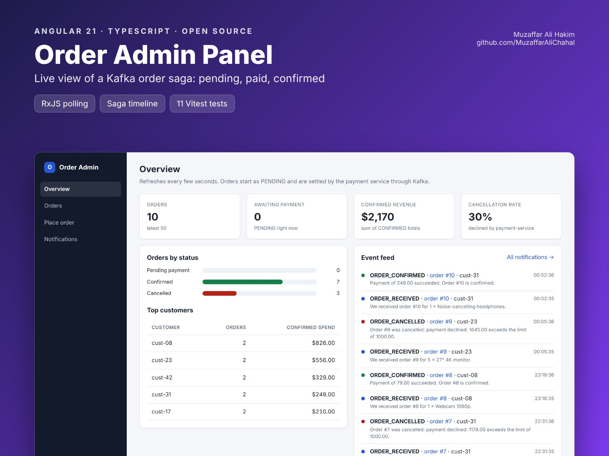

# Order Admin Panel (Angular)


   

An Angular 21 admin panel for my event-driven [order-microservices](https://github.com/MuzaffarAliChahal/order-microservices) (Spring Boot + Kafka).
It shows orders moving through the saga live: placed as `PENDING`, charged by payment-service, then `CONFIRMED` or `CANCELLED`.

**Live demo:** https://muzaffaralichahal.github.io/angular-order-admin-panel/ (the saga is simulated in your browser; tick "Simulate live traffic" to watch orders arrive)



## Features

- **Overview:** order counts, orders awaiting payment, confirmed revenue, cancellation rate, top customers and a live event feed
- **Orders:** list that refreshes itself, filtered by customer (sent to the API) and status
- **Order detail:** a saga timeline (saved → payment → confirmed or cancelled) that updates on its own while the order is pending, plus the notifications sent for it
- **Place order:** validated form that warns when the total is above the payment limit, then opens the new order so you can watch it settle
- **Notifications:** everything notification-service sent, by customer

## How it's built

| Concern | Approach |
| --- | --- |
| Live updates | A small `poll()` helper: `timer` + `switchMap` (drops stale responses) with errors turned into values so polling never dies |
| Stop when done | The detail page polls with `takeWhile(status === 'PENDING', inclusive)`, so it stops once the order settles |
| State | Signals and `computed()` for every derived number; `toSignal` / `toObservable` between signals and RxJS |
| API layer | Abstract `OrderApi`: `HttpOrderApi` calls the Spring Cloud Gateway; `DemoOrderApi` simulates the saga (idempotent settle, same 1,000.00 payment limit) |
| Tests | 11 Vitest tests, including the saga with fake timers, the timeline logic and the order form |

```
src/app/
├── core/
│   ├── models.ts       # mirrors OrderResponse / PlaceOrderRequest / Notification
│   ├── order-api.ts    # OrderApi + HTTP and demo (saga simulation) implementations
│   └── poll.ts         # resilient polling helper
├── pages/              # overview, orders, order-detail, new-order, notifications
└── shared/             # status badge
```

## Run it

```bash
npm install
npm start                          # demo mode at http://localhost:4200
npm test
```

Against the real services (`docker compose up` in [order-microservices](https://github.com/MuzaffarAliChahal/order-microservices), gateway on port 8080):

```bash
npx ng serve --configuration live  # proxies /api to http://localhost:8080
```

## Deployment

GitHub Actions runs the tests, builds with the right `--base-href`, and publishes the demo to GitHub Pages on every push to `main`.

## License

MIT
